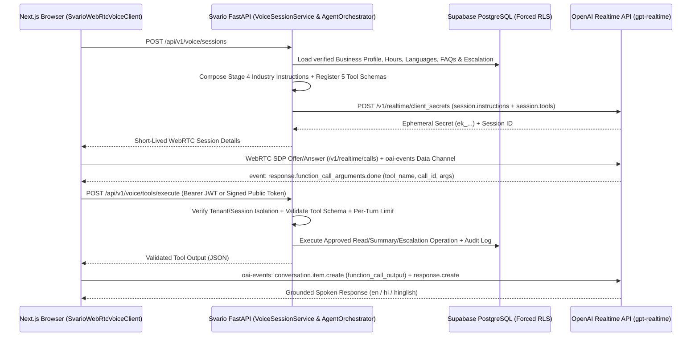

# SVARIO — Multi-Industry Architecture Specification

**Milestone:** Stage 4 — AI Agent & Conversational Intelligence  
**Roadmap Version:** 2.0  
**Tagline:** *AI that speaks for your business.*

---

## 1. Architectural Vision

**SVARIO** is a multi-industry AI Voice Agent Platform engineered for three high-call-volume service verticals:

1. **Salons** (`salon` / `app.agents.industries.salon`) — Beauty, hair, and wellness studios.
2. **Clinics** (`clinic` / `app.agents.industries.clinic`) — Outpatient, dental, dermatology, physiotherapy, and specialty clinics.
3. **Hospitals** (`hospital` / `app.agents.industries.hospital`) — Multi-specialty hospitals and institutional OPD switchboards.

### Core Separation of Concerns (Stage 4)
- **AI interprets and communicates.**
- **FastAPI validates and executes.**
- **Supabase is the source of truth.**

Svario separates **multi-tenant identity & organization governance** (`Stage 1`), **organization-scoped business onboarding** (`Stage 2`), **shared browser WebRTC voice infrastructure** (`Stage 3`), and **modular AI agent & conversational intelligence** (`Stage 4`) from **transactional appointment booking workflows** (`Stage 5+`).

---

## 2. Monorepo Topology (Stage 4)

```text
Voice agent-PS-03/
├── apps/
│   ├── web/                               # Next.js 15 (App Router) + TypeScript + Tailwind CSS v4
│   │   ├── src/
│   │   │   ├── app/
│   │   │   │   ├── page.tsx               # Platform Foundation page
│   │   │   │   ├── login/page.tsx         # Supabase email/password sign-in
│   │   │   │   ├── signup/page.tsx        # Operator registration + email verification
│   │   │   │   ├── forgot-password/page.tsx # Password recovery request
│   │   │   │   ├── reset-password/page.tsx  # Password reset completion
│   │   │   │   ├── onboarding/page.tsx    # Protected 8-step Stage 2 business onboarding wizard
│   │   │   │   ├── dashboard/page.tsx     # Protected workspace, org switcher & Voice Test Lab link
│   │   │   │   └── voice-test/page.tsx    # Stage 3–4 Browser WebRTC Voice & Agent Test Lab
│   │   │   ├── components/
│   │   │   │   ├── auth/                  # Reusable AuthShell, Login, Signup, Recovery forms
│   │   │   │   ├── organizations/         # OrganizationOnboardingForm & OrganizationSwitcher
│   │   │   │   ├── onboarding/            # OnboardingWizard (8-step wizard + healthcare notices)
│   │   │   │   └── voice/                 # VoiceOrbWaveform, VoiceSessionPanel & VoiceTestView
│   │   │   ├── context/
│   │   │   │   └── AuthOrganizationContext.tsx # Session restoration + active org context
│   │   │   ├── lib/
│   │   │   │   ├── api.ts                 # Typed FastAPI client (Stage 1–4 endpoints)
│   │   │   │   ├── supabase/client.ts     # Browser @supabase/supabase-js client
│   │   │   │   └── voice/                 # WebRTC client, 10-state machine, tool execution & events
│   │   │   ├── config/brand.ts
│   │   │   ├── types/platform.ts
│   │   │   └── __tests__/                 # Vitest + React Testing Library suite (Stages 1–4)
│   │   ├── package.json
│   │   └── vitest.config.ts
│   └── api/                               # Python + FastAPI + Pydantic v2 + PyJWT[crypto]
│       ├── app/
│       │   ├── agents/                    # Stage 4 Modular AI Agent Architecture
│       │   │   ├── base.py                # BaseIndustryAgent contract
│       │   │   ├── schemas.py             # 14 Intents, SafetyFlags, Tool I/O & Session Context schemas
│       │   │   ├── instructions.py        # Server-composed Stage 4 system prompts & 5 Realtime tools
│       │   │   ├── intent.py              # Typed IntentClassifier & multilingual detector (en/hi/hinglish)
│       │   │   ├── context.py             # Tenant-isolated ConversationContextManager & PII redaction
│       │   │   ├── orchestrator.py        # Controlled 9-step AgentOrchestrator & tool execution engine
│       │   │   ├── industries/            # SalonAgent, ClinicAgent & HospitalAgent
│       │   │   └── tools/                 # 5 backend-validated tools (profile, hours, FAQ, summary, escalation)
│       │   ├── core/
│       │   │   ├── config.py              # Pydantic settings (Supabase, JWKS, OpenAI Realtime, Rate Limit)
│       │   │   ├── auth.py                # SupabaseJWTVerifier + get_current_user dependency
│       │   │   └── errors.py              # Standardized JSON error handlers
│       │   ├── routes/
│       │   │   ├── root.py                # GET /
│       │   │   ├── health.py              # GET /health
│       │   │   ├── industries.py          # GET /architecture
│       │   │   ├── auth.py                # GET /api/v1/auth/me
│       │   │   ├── organizations.py       # POST/GET /api/v1/organizations & /members
│       │   │   ├── onboarding.py          # GET/PUT/POST/DELETE /api/v1/organizations/{id}/onboarding/*
│       │   │   └── voice.py               # POST /voice/sessions, /voice/tools/execute, /agent/turns & GET /context
│       │   ├── modules/
│       │   │   ├── organizations/         # Multi-tenant schemas, repository & RBAC service
│       │   │   ├── onboarding/            # Stage 2 schemas, repository & RBAC service
│       │   │   ├── voice/                 # Stage 3–4 session & tool execution service
│       │   │   ├── shared/                # Voice, AI, Scheduling, Notifications contracts
│       │   │   ├── salons/
│       │   │   ├── clinics/
│       │   │   └── hospitals/
│       │   └── main.py
│       ├── tests/                         # Pytest suite (Auth, Orgs, Onboarding, Voice, Stage 4 Agent & Eval)
│       └── requirements.txt
├── supabase/
│   └── migrations/                        # Stage 1, Stage 2 & Stage 4 PostgreSQL schemas & forced RLS policies
├── brand assets/                          # Preserved official color system & brand references
├── docs/
└── infra/
```

---

## 3. Stage 4 Realtime Voice & Controlled Agent Tool-Calling Flow



### Voice Session State Machine (10 Explicit States)
- `idle`: Initial standby state prior to session initiation.
- `requesting_permission`: Prompting browser `navigator.mediaDevices.getUserMedia`.
- `connecting`: Minting short-lived backend credential and negotiating WebRTC SDP offer/answer.
- `connected`: `RTCPeerConnection` established; awaiting data channel readiness.
- `listening`: Active microphone stream and `oai-events` channel ready for caller speech.
- `processing`: Caller turn committed (`input_audio_buffer.speech_stopped`); synthesizing AI response.
- `speaking`: AI voice output streaming over remote `<audio>` track (supports instant barge-in interruption).
- `reconnecting`: Tearing down prior `RTCPeerConnection`/tracks and establishing a fresh session without leaks.
- `error`: Recoverable or non-recoverable failure (`MICROPHONE_PERMISSION_DENIED`, `MICROPHONE_NOT_FOUND`, `SESSION_EXPIRED`, `SDP_NEGOTIATION_FAILED`, etc.).
- `ended`: Cleanly disconnected with all microphone tracks stopped and peer connection closed.
