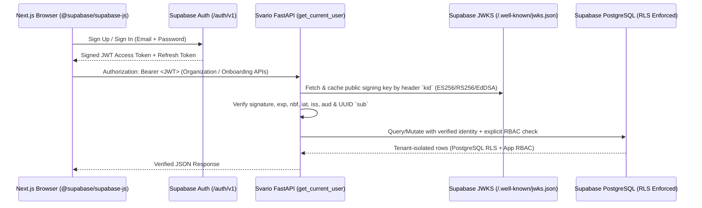
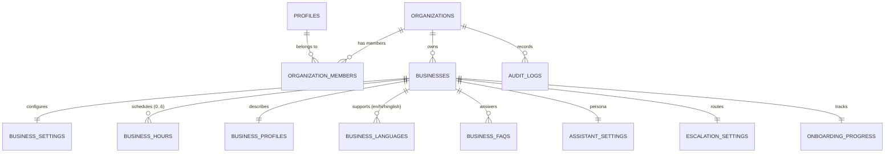

# SVARIO — Multi-Industry Architecture Specification

**Milestone:** Stage 2 — Industry Selection & Business Onboarding  
**Roadmap Version:** 2.0  
**Tagline:** *AI that speaks for your business.*

---

## 1. Architectural Vision

**SVARIO** is a multi-industry AI Voice Agent Platform engineered for three high-call-volume service verticals:

1. **Salons** (`salon` / `app.modules.salons`) — Beauty, hair, and wellness studios.
2. **Clinics** (`clinic` / `app.modules.clinics`) — Outpatient, dental, dermatology, physiotherapy, and specialty clinics.
3. **Hospitals** (`hospital` / `app.modules.hospitals`) — Multi-specialty hospitals and institutional OPD switchboards.

Svario separates **multi-tenant identity & organization governance** (`Stage 1`), **organization-scoped business onboarding** (`Stage 2`), and **shared infrastructure subsystems** (Voice, AI Policy, Scheduling, Notifications) from **industry-specific domain modules**.

---

## 2. Monorepo Topology (Stage 2)

```text
Voice agent-PS-03/
├── apps/
│   ├── web/                               # Next.js 15 (App Router) + TypeScript + Tailwind CSS v4
│   │   ├── src/
│   │   │   ├── app/
│   │   │   │   ├── page.tsx               # Platform Foundation page
│   │   │   │   ├── login/page.tsx         # Supabase email/password sign-in
│   │   │   │   ├── signup/page.tsx        # Operator registration + email verification
│   │   │   │   ├── forgot-password/page.tsx # Password recovery request
│   │   │   │   ├── reset-password/page.tsx  # Password reset completion
│   │   │   │   ├── onboarding/page.tsx    # Protected 8-step Stage 2 business onboarding wizard
│   │   │   │   └── dashboard/page.tsx     # Protected workspace, org switcher & onboarding summary
│   │   │   ├── components/
│   │   │   │   ├── auth/                  # Reusable AuthShell, Login, Signup, Recovery forms
│   │   │   │   ├── organizations/         # OrganizationOnboardingForm & OrganizationSwitcher
│   │   │   │   ├── onboarding/            # OnboardingWizard (8-step wizard + healthcare notices)
│   │   │   │   └── ...                    # Stage 0 foundation components
│   │   │   ├── context/
│   │   │   │   └── AuthOrganizationContext.tsx # Session restoration + active org context
│   │   │   ├── lib/
│   │   │   │   ├── api.ts                 # Typed FastAPI client (Stage 1 orgs + Stage 2 onboarding)
│   │   │   │   └── supabase/client.ts     # Browser @supabase/supabase-js client
│   │   │   ├── config/brand.ts
│   │   │   ├── types/platform.ts
│   │   │   └── __tests__/                 # Vitest + React Testing Library suite (Stage 1 & Stage 2)
│   │   ├── package.json
│   │   └── vitest.config.ts
│   └── api/                               # Python + FastAPI + Pydantic v2 + PyJWT[crypto]
│       ├── app/
│       │   ├── core/
│       │   │   ├── config.py              # Pydantic settings (Supabase, JWKS, CORS)
│       │   │   ├── auth.py                # SupabaseJWTVerifier + get_current_user dependency
│       │   │   └── errors.py              # Standardized JSON error handlers
│       │   ├── routes/
│       │   │   ├── root.py                # GET /
│       │   │   ├── health.py              # GET /health
│       │   │   ├── industries.py          # GET /architecture
│       │   │   ├── auth.py                # GET /api/v1/auth/me
│       │   │   ├── organizations.py       # POST/GET /api/v1/organizations & /members
│       │   │   └── onboarding.py          # GET/PUT/POST/DELETE /api/v1/organizations/{id}/onboarding/*
│       │   ├── modules/
│       │   │   ├── organizations/         # Multi-tenant schemas, repository & RBAC service
│       │   │   ├── onboarding/            # Stage 2 schemas, repository & RBAC service
│       │   │   ├── shared/                # Voice, AI, Scheduling, Notifications contracts
│       │   │   ├── salons/
│       │   │   ├── clinics/
│       │   │   └── hospitals/
│       │   └── main.py
│       ├── tests/                         # Pytest suite (Auth, Orgs, Onboarding, RLS Audit, Live RLS)
│       └── requirements.txt
├── supabase/
│   └── migrations/
│       ├── 20261103000001_stage1_core_schema.sql
│       ├── 20261103000002_stage1_rls_policies.sql
│       ├── 20261108000003_stage2_onboarding_schema.sql
│       └── 20261108000004_stage2_onboarding_rls.sql
├── brand assets/                          # Preserved official color system & brand references
├── docs/
└── infra/
```

---

## 3. Authentication & JWT Verification Architecture



---

## 4. Multi-Tenant Organization & Stage 2 Onboarding Data Model



### Stage 2 Onboarding Workflow (8 Steps)
1. **Industry Selection (`industry`):** Confirms or updates the organization's vertical (`salon | clinic | hospital`; restricted to `owner`/`admin`).
2. **Business Profile (`profile`):** Configures `display_name`, `description`, `phone`, `email`, `website`, `address`, `city`, `state`, `country`, `postal_code`, and `timezone` (1:1 per business).
3. **Operating Hours (`hours`):** Configures 7-day weekly schedule (`0=Sunday .. 6=Saturday`) with open/close times, closed toggle, and `is_overnight` support.
4. **Languages (`languages`):** Configures primary language (`en | hi | hinglish`) and additional supported languages (`hinglish` documented as a conversational preference rather than a formal ISO locale).
5. **Assistant Configuration (`assistant`):** Stores `assistant_name`, `greeting`, `personality` (`professional | friendly | warm`), `response_style` (`concise | balanced | detailed`), and `enabled` flag. Does **not** activate live OpenAI Realtime sessions in Stage 2.
6. **Business FAQs (`faqs`):** Full CRUD (`create`, `read`, `update`, `delete`, `is_active`, `sort_order`) plus editable industry starter templates.
7. **Human Escalation & Healthcare Safeguards (`escalation`):** Configures human fallback contact (`contact_name`, `contact_email`, `contact_phone`, `preferred_method`, `escalation_instructions`) and enforces administrative-only healthcare safeguards for `clinic` and `hospital` organizations.
8. **Review & Complete (`review`):** Summarizes all configured sections and persists `is_completed = true` with `completed_at` timestamp in `onboarding_progress`.
